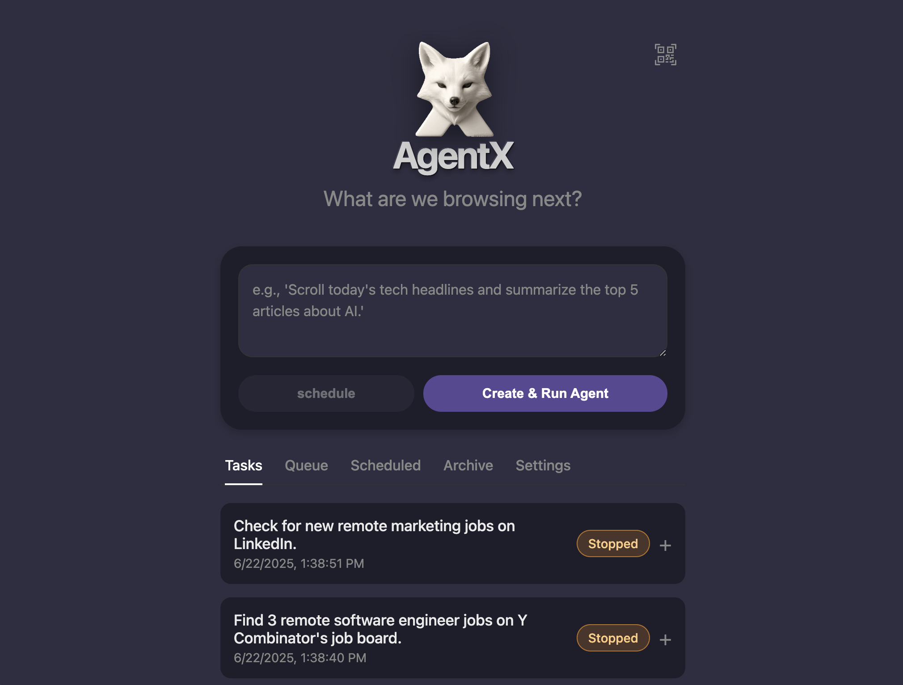

# AgentX by SapienX

<p align="center">
  
</p>

<p align="center">
  <strong>An autonomous AI agent that understands natural language, creates a plan, and executes complex tasks in a web browser using specialized tools.</strong>
</p>

<p align="center">
  <a href="#getting-started">Getting Started</a> •
  <a href="#how-it-works">How It Works</a> •
  <a href="#key-features">Key Features</a> •
  <a href="#usage-guide">Usage Guide</a> •
  <a href="#tech-stack">Tech Stack</a>
</p>

---

## Getting Started

Get the BrowserX Agent running on your machine in a few simple steps.

### 1. Prerequisites

- [Node.js](https://nodejs.org/en/download/) (v18 or later is recommended).

### 2. Clone the Repository

Open your terminal, navigate to where you want to store the project, and run:

```bash
git clone https://github.com/SapienXai/agentx.git
cd agentx
```

### 3. Install Dependencies

This single command installs all necessary packages for the app and the MCP browser integration.

```bash
npm install
```

### 4. Set Up API Keys

The agent relies on a few powerful services for its intelligence, search, and scraping capabilities.

Create a `.env` file in the root of the project directory. You can do this by copying the example file:

```bash
cp .env.example .env
```

(If `.env.example` doesn't exist, just create a new file named `.env`)

Edit the `.env` file and add your API keys. It should look like this:

```ini
# .env

# Required for planning and decision-making
OPENAI_API_KEY=sk-...

# Optional: advanced web search (falls back to browser automation if missing)
TAVILY_API_KEY=tvly-...

# Optional: reliable web scraping (falls back to browser automation if missing)
FIRECRAWL_API_KEY=fc-...
```

**How to Get Your API Keys:**

- **🔑 OpenAI**: Required for the agent's core intelligence.
  - Get your key: [platform.openai.com/api-keys](https://platform.openai.com/api-keys)
  - Note: You'll need to have some credits on your OpenAI account. New accounts often come with free trial credits.

- **🔑 Tavily AI** (Optional): The agent's specialized search tool. If missing, the agent will fall back to browser automation.
  - Get your key: [app.tavily.com](https://app.tavily.com)
  - Note: Tavily offers a generous free tier with 1,000 API calls per month.

- **🔑 Firecrawl** (Optional): The agent's web scraping tool, for instantly turning websites into clean, usable data. If missing, the agent will fall back to browser automation.
  - Get your key: [firecrawl.dev](https://firecrawl.dev)
  - Note: Firecrawl also has a free tier that is sufficient for most use cases.

**Important**: The application can start without Tavily/Firecrawl. You only need a working LLM provider (OpenAI API key or Codex/Gemini CLI login).

### 5. Run the Application

You're all set! First, ensure all dependencies are installed:

```bash
npm install
```

Then, start the agent with:

```bash
npm run dev
```

The Tauri application window will open, and you can start giving the agent tasks.

<p align="center">
  
  <br>
  <em>The AgentX interface, showing task management, scheduling, and remote control access.</em>
</p>

---

## How It Works

The agent operates on a sophisticated loop that combines high-level planning with intelligent, tool-based execution. This "tool-first" approach makes it faster and more reliable than agents that rely solely on visual analysis.


### Goal Input & Planning:

- The user provides a high-level goal (e.g., "Find the top 3 AI news headlines from Google News and summarize them").
- The `createToolPlan` function sends this goal to the active LLM provider, which returns a structured JSON plan, including a task summary, a target URL, recurring schedule information (if any), and a high-level step list.
- **User Approval**: The generated plan is displayed in the UI for user confirmation.

### Autonomous Execution Loop (`runAutonomousAgent`):

- Once approved, the agent starts its execution loop. The core logic is handled by the `decideNextToolAction` step controller.
- **Tool Selection**: For each step, the controller analyzes the goal, plan, and previous action results to choose the best tool for the job from the live MCP tool catalog (plus optional Tavily/Firecrawl if enabled).
- **Action Execution**: The chosen action (e.g., `navigate`, `click`, `type`, `tavily_search`, `summarize`, `finish`) is executed.
- **Feedback & Iteration**: The result of the action (e.g., search results, scraped content, or an error message) is fed back into the controller for the next iteration. This allows the agent to self-correct and replan when the page state changes (captcha, access denied, empty content).
- **Completion**: The loop continues until the `finish` action is called with a final summary, the agent is stopped by the user, or it reaches the maximum step limit.

---

## Key Features

- 🧠 **Advanced AI Planning**: Leverages GPT-4o to create structured, actionable plans from natural language inputs.
- 🔍 **Intelligent Web Search**: Uses Tavily AI for optimized, AI-agent-friendly search results.
- 📊 **Reliable Web Scraping**: Firecrawl ensures clean, structured data extraction from websites.
- 🌐 **Browser Automation**: Chrome DevTools MCP handles browser interactions with tool-aware step control.
- 🖥️ **User-Friendly Interface**: Built with Tauri for a seamless desktop experience, including task management and scheduling.
- 🔄 **Self-Correcting Loop**: The agent adapts to errors or unexpected results by re-evaluating and choosing alternative actions.

---

## Usage Guide

1. **Launch the Application**:
   - Run `npm run dev` to open the Tauri app.
2. **Enter a Goal**:
   - In the UI, type a natural language goal (e.g., "Summarize the latest AI research papers from arXiv").
3. **Review the Plan**:
   - The agent will generate a step-by-step plan for approval.
4. **Execute the Task**:
   - Approve the plan, and the agent will autonomously execute it, using the appropriate tools.
5. **Monitor Progress**:
   - Watch the agent's progress in the UI, with logs and results displayed in real-time.
6. **Stop or Adjust**:
   - Pause or stop the agent at any time, or modify the goal to start a new task.

---

## Tech Stack

- **Core AI**: OpenAI GPT-4o for planning and decision-making.
- **Search**: Tavily AI for advanced web search.
- **Scraping**: Firecrawl for reliable web data extraction.
- **Browser Automation**: Chrome DevTools MCP for browser control.
- **Frontend/Backend**: Tauri for the desktop application.
- **Runtime**: Node.js for JavaScript execution.
- **Dependencies**: Managed via npm.
